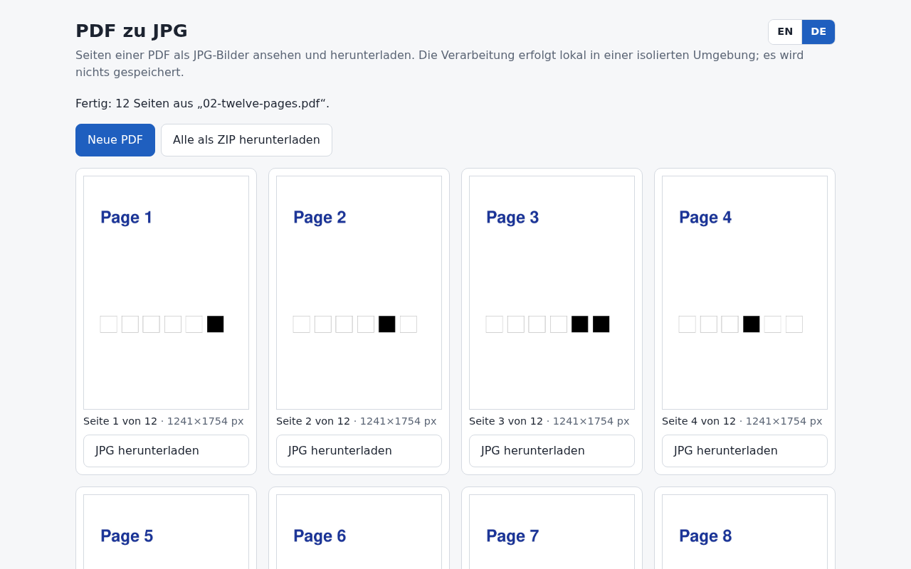
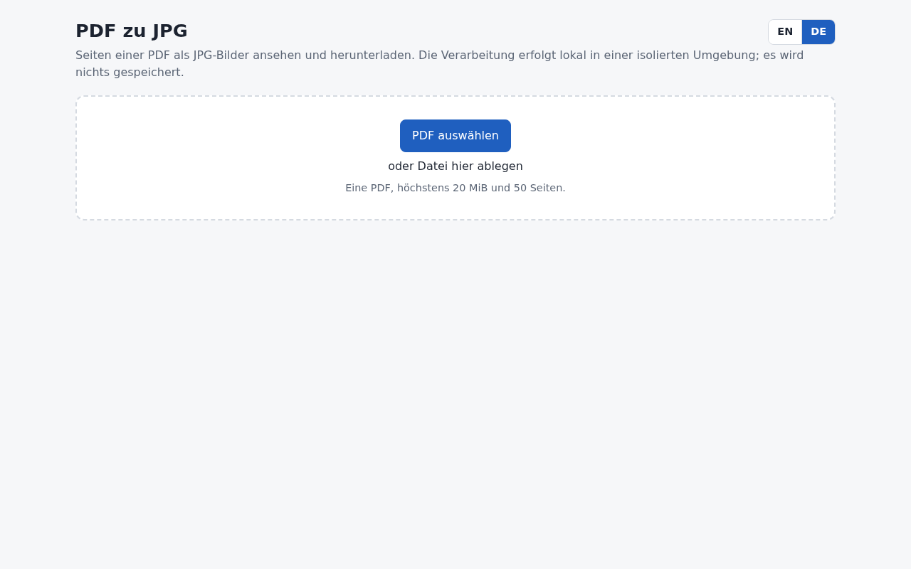
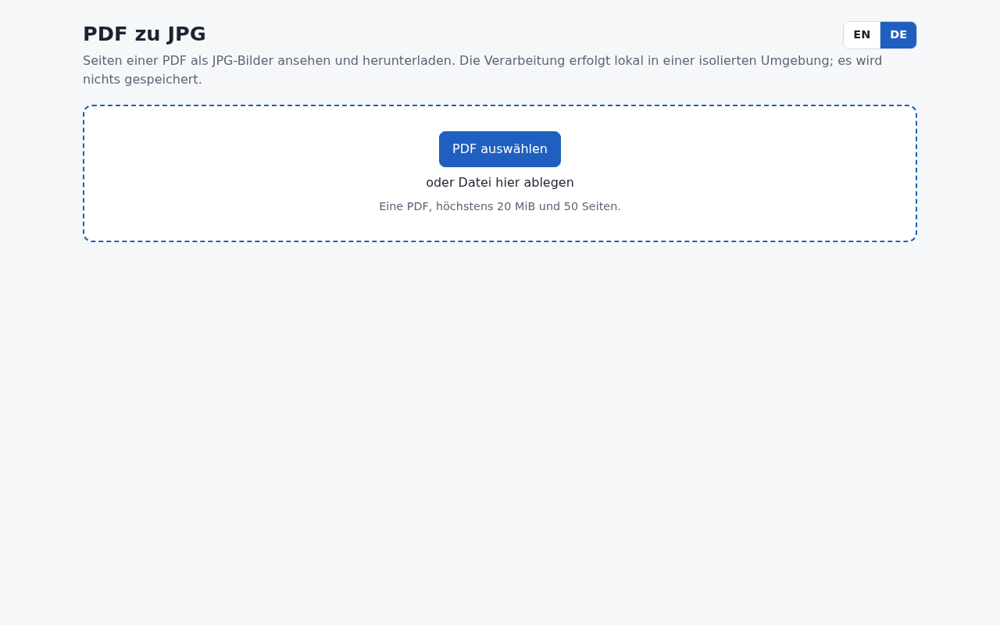
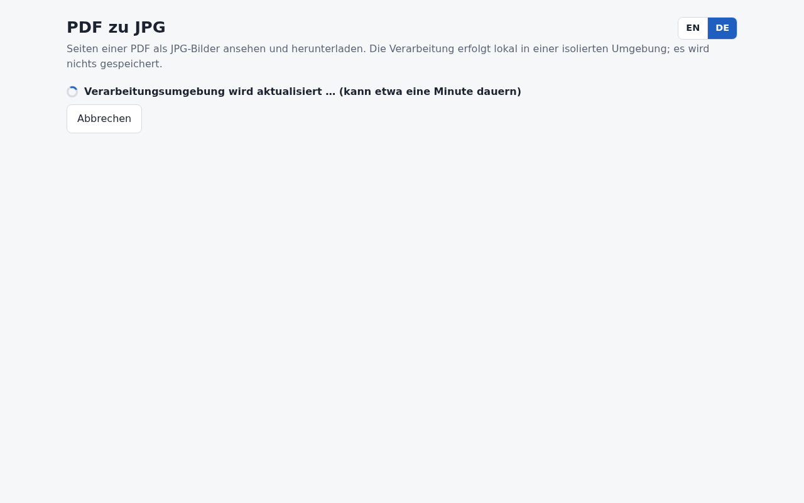
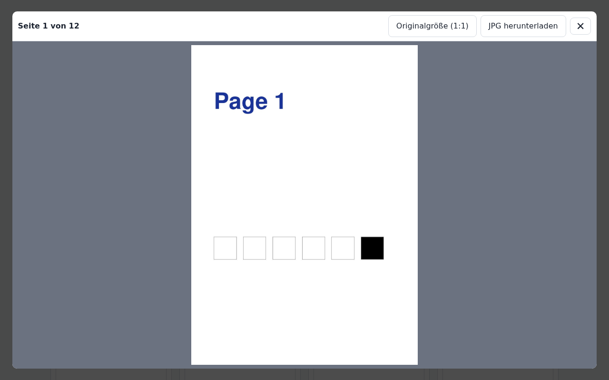
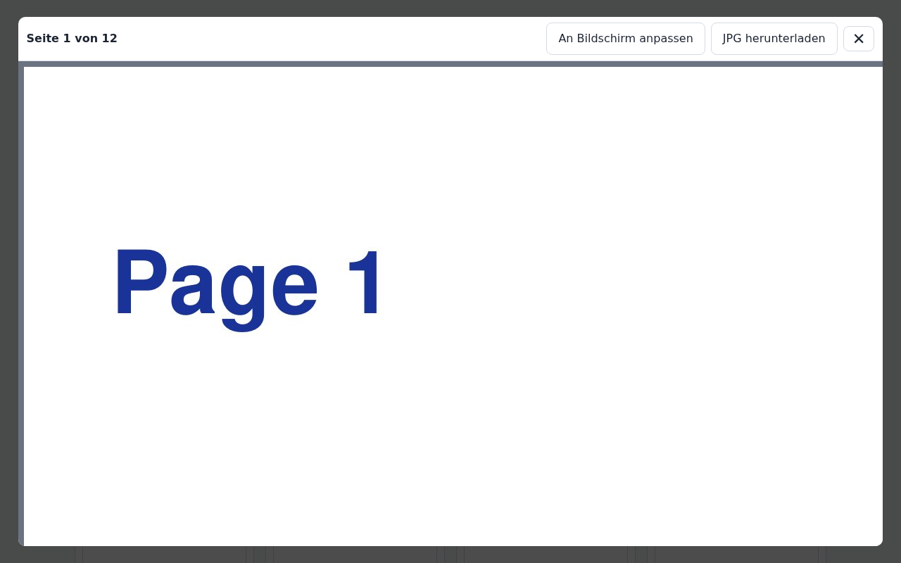
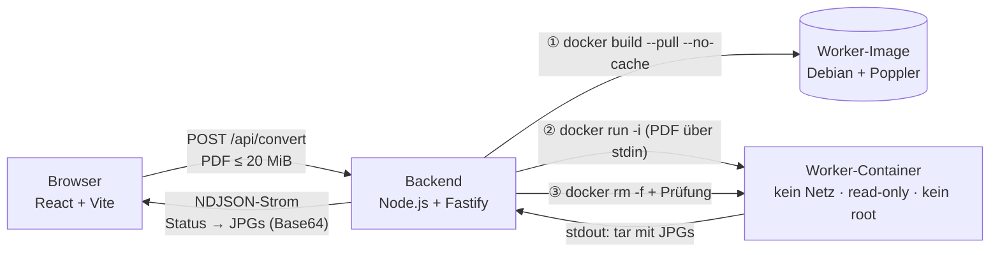

<div align="center">

# PDF to JPG Sandbox

[English](README.md) · **Deutsch**

[](https://github.com/devzoltan/pdf-to-jpg-sandbox/actions/workflows/ci.yml)
[](LICENSE)


Seiten einer PDF in JPG-Bilder umwandeln – **jede Datei wird in einem neuen Docker-Container ohne Netzwerk und mit schreibgeschütztem Dateisystem gerendert, der danach sofort entfernt wird.** Es wird nichts gespeichert, weder auf dem Server noch im Browser.



</div>

## Warum

PDF-Parser sind eine klassische Angriffsfläche, und PDFs kommen oft aus nicht vertrauenswürdigen Quellen (E-Mail-Anhänge, Uploads). Diese Anwendung hält den Parser – [Poppler](https://poppler.freedesktop.org/) – in einem wegwerfbaren, abgeschotteten Container und behandelt auch alles, was dieser liefert, als nicht vertrauenswürdig. Die Webanwendung selbst analysiert die PDF nie.

## Funktionen

- **Eine PDF pro Vorgang** per Dateiauswahl oder Drag & Drop (höchstens 20 MiB, 50 Seiten)
- **Ehrliche Statusanzeige** – „Verarbeitungsumgebung wird aktualisiert“ → „Verarbeitung läuft“, kein vorgetäuschter Fortschrittsbalken
- **Vorschau aus den erzeugten JPGs**, vergrößerte Ansicht (an Bildschirm anpassen / Originalgröße 1:1), Download je Seite als JPG und aller Seiten als ZIP
- **Oberfläche auf Englisch / Deutsch** mit Sprachumschalter (Standard Englisch, `?lang=de` für Deutsch)
- **Barrierearm und responsiv** – vollständig per Tastatur bedienbar, Fokusführung, funktioniert auf dem Telefon
- **Frischer Worker für jeden Auftrag** – das Image wird vor jeder Umwandlung neu gebaut (`--pull --no-cache`), damit stets die aktuellen Debian-Sicherheitsupdates und Poppler verwendet werden
- **Keine Speicherung** – keine Datenbank, keine Dateien auf der Platte, kein Browser-Speicher, `Cache-Control: no-store`
- Verschlüsselte / passwortgeschützte PDFs werden mit einer klaren Meldung abgelehnt

## Bildschirmfotos

| Start | Datei über der Ablagefläche | Vorbereitung der Umgebung |
| --- | --- | --- |
|  |  |  |

| Ergebnis | Vergrößerte Ansicht (Bildschirm) | Vergrößerte Ansicht (1:1) |
| --- | --- | --- |
|  |  |  |

## Funktionsweise



1. Der Browser lädt die PDF hoch (der ursprüngliche Dateiname wird nie übertragen). Das Backend prüft die Größe schon beim Einlesen, kontrolliert die `%PDF-`-Signatur und erlaubt **einen Auftrag gleichzeitig** (eine zweite Anfrage erhält `409 Busy`).
2. Vor jedem Auftrag wird das Worker-Image aus einem frisch geladenen Basis-Image ohne Build-Cache neu gebaut. Der Auftrag läuft mit **genau der Image-ID dieses Builds**; schlägt die Aktualisierung fehl, wird nicht mit einem alten Image verarbeitet.
3. Ein neuer Container erhält die PDF über stdin. Darin prüft `pdfinfo` Verschlüsselung und Seitenzahl, `pdftoppm` rendert jede Seite mit ≤ 150 DPI, wobei die längste Seite **proportional** auf ≤ 2000 px skaliert wird. Das Ergebnis verlässt den Container als tar-Strom über stdout.
4. Das Backend prüft den Strom (Byte-Grenzen, erwartete Dateinamen, JPEG-Kopf und -Abmessungen), streamt die Seiten an den Browser und **entfernt den Container mit Kontrolle, dass er wirklich weg ist** – bei Erfolg, Fehler, Zeitüberschreitung, Abbruch durch den Client und beim Herunterfahren.
5. Der Browser hält die JPGs nur als Blobs im Arbeitsspeicher; „Neue PDF“ gibt alle Object-URLs frei.

### Abschottung des Workers

| Maßnahme | Einstellung |
| --- | --- |
| Netzwerk | `--network none` |
| Dateisystem | `--read-only`, nur ein 128-MiB-`tmpfs` unter `/work` (`noexec,nosuid,nodev`) |
| Benutzer / Rechte | UID 10001, `--cap-drop ALL`, `no-new-privileges` |
| Ressourcen | 1 CPU, 512 MiB RAM ohne Swap, 64 Prozesse, `nofile=256` |
| Zeit | 60 s Renderzeit im Backend + harte Grenze von 75 s im Container |
| Logs | `--log-driver none` (Bilddaten landen nie in Docker-Logs) |
| Eingaben | Feste Argumentliste, keine Shell; nichts aus der Anfrage gelangt in Docker-Optionen |

Bedrohungsmodell und Grenzen: [SECURITY.de.md](SECURITY.de.md).

## Schnellstart

**Voraussetzungen:** Docker (Engine oder Desktop, BuildKit), Node.js 24 LTS, Internetzugang für die Image-Aktualisierung (Docker Hub + Debian-Spiegel).

```bash
git clone https://github.com/devzoltan/pdf-to-jpg-sandbox.git
cd pdf-to-jpg-sandbox
npm ci
npm start          # baut und startet http://localhost:8080
```

Jeder Auftrag dauert zunächst etwa 20–40 s, weil das Worker-Image neu gebaut wird. Der Server lauscht nur auf `127.0.0.1`. Beenden mit `Strg+C` – ein laufender Auftrag wird abgebrochen und sein Container entfernt.

<details>
<summary>Hinweise zu Windows / WSL2</summary>

- Docker Desktop mit aktivierter WSL2-Integration verwenden; `docker version` muss in WSL funktionieren.
- Schlägt das Laden von Images mit `docker-credential-desktop.exe: exec format error` fehl, ist das WSL-Interop deaktiviert (häufig mit `systemd=true`). Wieder aktivieren:
  ```bash
  sudo sh -c 'echo ":WSLInterop:M::MZ::/init:PF" > /usr/lib/binfmt.d/WSLInterop.conf'
  sudo sh -c 'echo ":WSLInterop:M::MZ::/init:PF" > /proc/sys/fs/binfmt_misc/register'
  ```
- Browser unter Windows erreichen die Anwendung unter `http://localhost:8080` (die WSL-Weiterleitung kann nach dem Start einige Sekunden brauchen).

</details>

## Konfiguration

| Variable | Standard | Beschreibung |
| --- | --- | --- |
| `PORT` | `8080` | HTTP-Port |
| `HOST` | `127.0.0.1` | Lauschadresse – auf Loopback lassen und für Fernzugriff einen Reverse Proxy verwenden |
| `WORKER_BASE_IMAGE` | `debian:trixie-slim` | Basis-Image des Workers (z. B. ein interner Registry-Spiegel) |

| Grenze | Wert |
| --- | --- |
| PDF-Größe | 20 MiB (beim Einlesen geprüft) |
| Seiten | 50 (im Worker vor dem Rendern geprüft) |
| Bildqualität | 150 DPI, JPEG-Qualität 85, längste Seite ≤ 2000 px (proportional) |
| Ergebnis gesamt | 50 MiB (im Worker und im Backend geprüft) |
| Renderzeit | 60 s (+ harte Grenze von 75 s im Container) |
| Image-Aktualisierung | 5 min |
| Gleichzeitige Aufträge | 1 |

Die Grenzen sind in [`server/config.ts`](server/config.ts) festgelegt.

## Skripte

| Befehl | Zweck |
| --- | --- |
| `npm start` | Bauen und Server starten |
| `npm run dev` | Backend (Watch) + Vite-Entwicklungsserver unter http://localhost:5173 |
| `npm run worker:update` | Worker-Image neu bauen und selbst testen (zeigt Image-ID und Poppler-Version) |
| `npm run typecheck` | TypeScript für Server, Frontend, Tests und Skripte |
| `npm test` | Integrations- und Lebenszyklustests mit **echtem** Docker-Worker |
| `npm run test:e2e` | Playwright-Browsertests gegen den gebauten Server |
| `npm run samples` | Synthetische Beispiel-PDFs in `samples/` erzeugen |
| `npm run screenshots` | Bildschirmfotos neu erzeugen (Server muss laufen) |
| `npm run cleanup` | Verbliebene Worker-Container dieses Projekts entfernen (per Label) |

## Tests

Keine Mocks im kritischen Pfad: Die Tests starten den echten Server, bauen das echte Worker-Image und führen echte Container aus. Abgedeckt sind normale Umwandlungen (Inhalt und Reihenfolge werden über ein maschinenlesbares Muster in jedem erzeugten JPG geprüft), ungültige und verschlüsselte Eingaben, alle Grenzen, Zeitüberschreitung, Speichermangel, Abbruch durch den Client, `SIGTERM`/`SIGKILL` des Backends, Nebenläufigkeit, die Abschottung (`docker inspect` plus funktionale Prüfungen) und die Image-Aktualisierung pro Auftrag. Details: [docs/TESTING.de.md](docs/TESTING.de.md).

## Betrieb

Leitfaden für den Betrieb als systemd-Dienst hinter einem Reverse Proxy, einschließlich der Punkte, die der Betrieb entscheiden muss (Docker-Zugriff, Proxy, Build-Cache): [docs/DEPLOYMENT.de.md](docs/DEPLOYMENT.de.md).

## Projektstruktur

```
server/   Fastify-Backend: Grenzen, ein Auftragsplatz, Docker-Steuerung, Ergebnisprüfung, Bereinigung
web/      React- + Vite-Frontend (EN/DE), im Betrieb vom Backend ausgeliefert
worker/   Dockerfile und convert.sh (Poppler) – einziger Docker-Build-Kontext
tests/    synthetischer Testdaten-Generator, Integrations-, Lebenszyklus- und Playwright-Tests
scripts/  Worker-Aktualisierung, Aufräumen, Beispieldateien, Bildschirmfotos
docs/     Betriebs- und Testleitfaden, Bildschirmfotos
```

**Technologien:** Node.js 24 · TypeScript · Fastify 5 · React 19 · Vite 8 · Poppler · Docker · Vitest · Playwright

> Die Vorschau ist keine Virenprüfung und keine Aussage darüber, ob eine Datei unbedenklich ist.

## Lizenz

[MIT](LICENSE) © devzoltan
