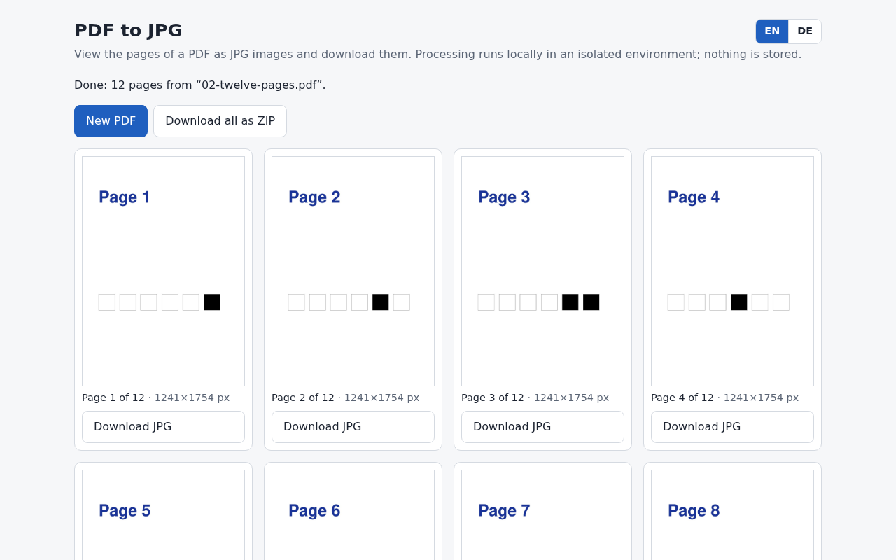
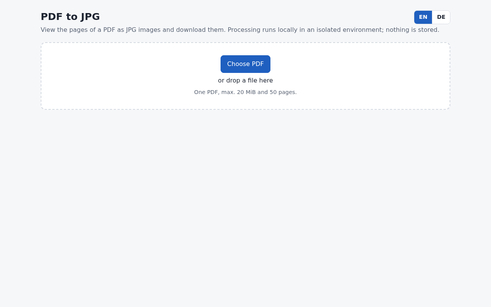
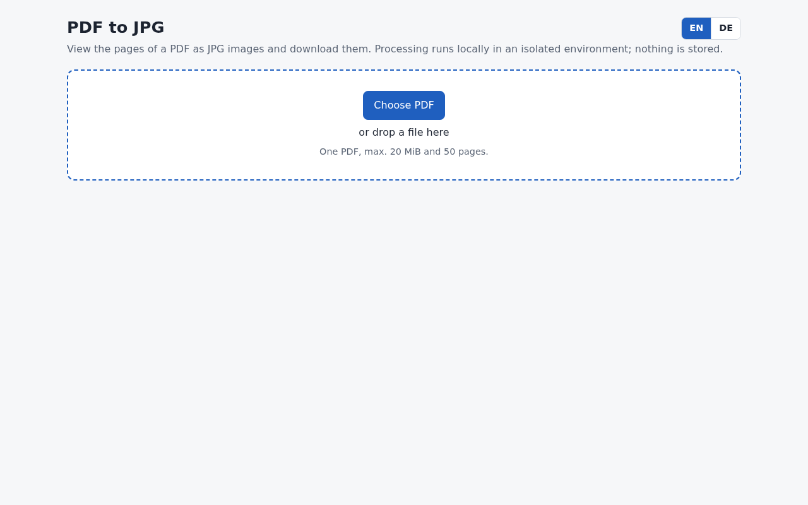
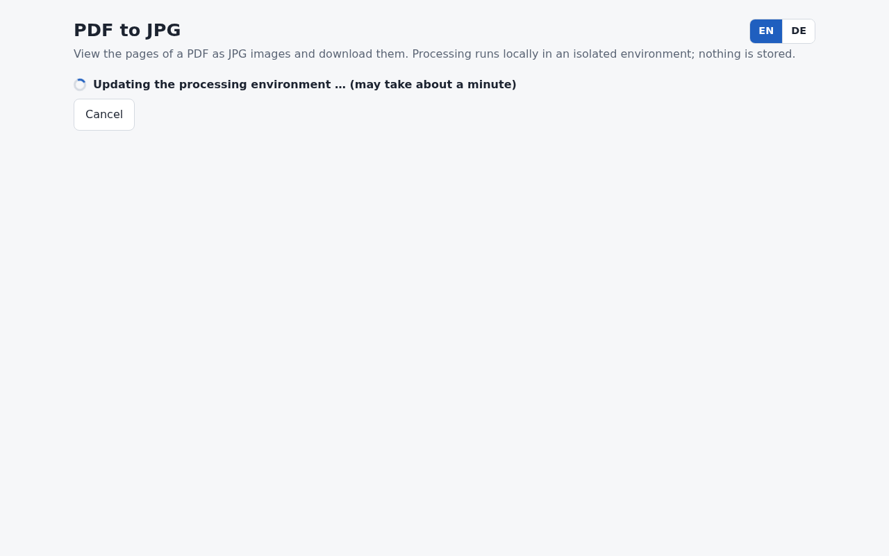
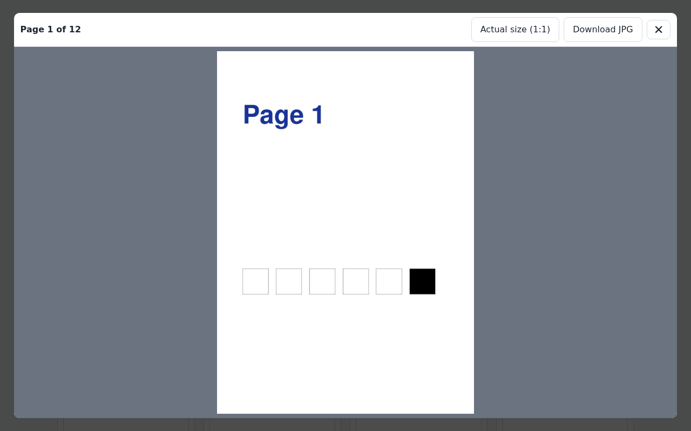
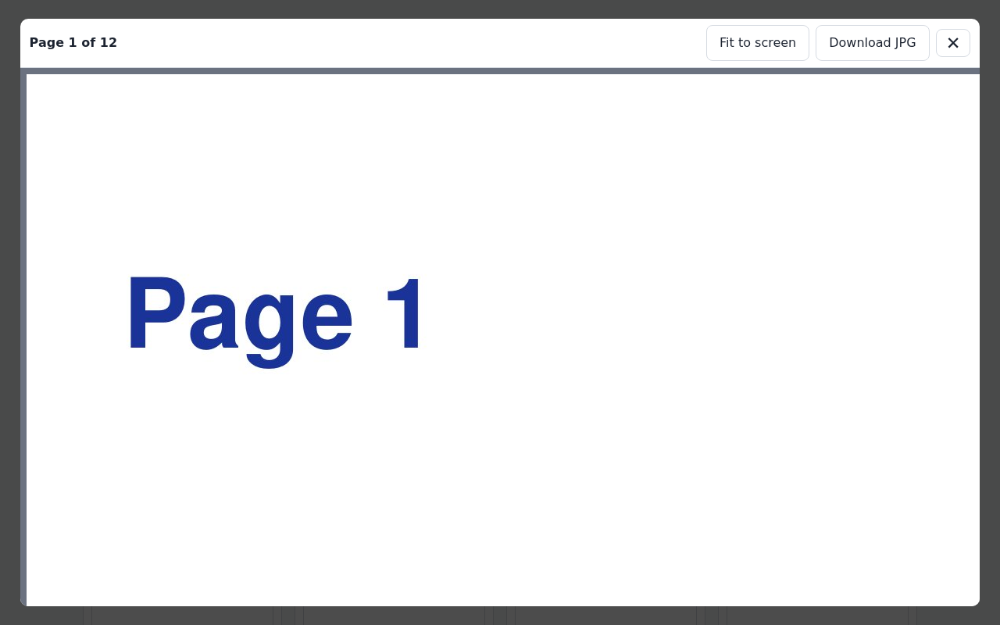
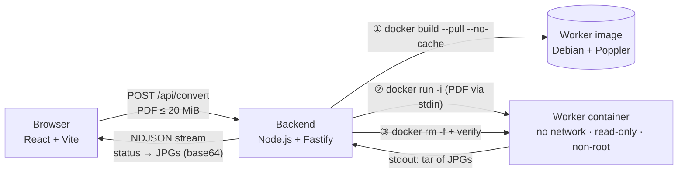

<div align="center">

# PDF to JPG Sandbox

**English** · [Deutsch](README.de.md)

[](https://github.com/devzoltan/pdf-to-jpg-sandbox/actions/workflows/ci.yml)
[](LICENSE)


Convert the pages of a PDF into JPG images – **every file is rendered in a fresh, network-less, read-only Docker container that is destroyed right afterwards.** Nothing is stored, neither on the server nor in the browser.



</div>

## Why

PDF parsers are a classic attack surface, and PDFs often arrive from untrusted sources (e-mail attachments, uploads). This app keeps the parser – [Poppler](https://poppler.freedesktop.org/) – inside a disposable, locked-down container and treats everything it produces as untrusted, too. The web app itself never parses the PDF.

## Features

- **One PDF at a time** via file picker or drag & drop (max. 20 MiB, 50 pages)
- **Honest status** – "updating the processing environment" → "processing", no fake progress bar
- **Preview from the rendered JPGs**, enlarged view (fit to screen / actual size 1:1), per-page JPG download and a ZIP of all pages
- **English / German UI** with a language switch (default English, `?lang=de` for German)
- **Accessible and responsive** – full keyboard support, focus management, works on phones
- **Fresh worker for every job** – the image is rebuilt (`--pull --no-cache`) before each conversion, so the latest Debian security updates and Poppler are always used
- **No persistence** – no database, no files on disk, no browser storage, `Cache-Control: no-store`
- Encrypted / password-protected PDFs are rejected with a clear message

## Screenshots

| Start | File dragged over the drop zone | Preparing the environment |
| --- | --- | --- |
|  |  |  |

| Result | Enlarged view (fit to screen) | Enlarged view (actual size) |
| --- | --- | --- |
|  |  |  |

## How it works



1. The browser uploads the PDF (the original file name is never sent). The backend enforces the size limit while reading, checks the `%PDF-` signature and allows **one job at a time** (a second request gets `409 Busy`).
2. Before every job the worker image is rebuilt from a freshly pulled base image without build cache. The job runs with the **exact image ID of that build**; if the update fails, nothing is processed with an old image.
3. A new container receives the PDF on stdin. Inside, `pdfinfo` checks encryption and page count, `pdftoppm` renders each page at ≤ 150 DPI with the longest side scaled **proportionally** to ≤ 2000 px. The result leaves the container as a tar stream on stdout.
4. The backend validates the stream (byte limits, expected file names, JPEG headers and dimensions), streams the pages to the browser and **removes the container, verifying that it is gone** – on success, error, timeout, client abort and shutdown.
5. The browser keeps the JPGs only as in-memory Blobs; "New PDF" revokes every object URL.

### Worker sandbox

| Measure | Setting |
| --- | --- |
| Network | `--network none` |
| File system | `--read-only`, only a 128 MiB `tmpfs` at `/work` (`noexec,nosuid,nodev`) |
| User / privileges | UID 10001, `--cap-drop ALL`, `no-new-privileges` |
| Resources | 1 CPU, 512 MiB RAM without swap, 64 processes, `nofile=256` |
| Time | 60 s render timeout in the backend + hard 75 s limit inside the container |
| Logs | `--log-driver none` (image data never ends up in Docker logs) |
| Inputs | Fixed argument list, no shell; nothing from the request reaches Docker options |

See [SECURITY.md](SECURITY.md) for the threat model and limitations.

## Quick start

**Requirements:** Docker (Engine or Desktop, BuildKit), Node.js 24 LTS, internet access for the image update (Docker Hub + Debian mirrors).

```bash
git clone https://github.com/devzoltan/pdf-to-jpg-sandbox.git
cd pdf-to-jpg-sandbox
npm ci
npm start          # builds and serves http://localhost:8080
```

The first conversion of every job takes about 20–40 s because the worker image is rebuilt. The server listens on `127.0.0.1` only. Stop it with `Ctrl+C` – a running job is cancelled and its container removed.

<details>
<summary>Windows / WSL2 notes</summary>

- Use Docker Desktop with WSL2 integration enabled; `docker version` must work inside WSL.
- If image pulls fail with `docker-credential-desktop.exe: exec format error`, WSL interop is disabled (common with `systemd=true`). Re-enable it:
  ```bash
  sudo sh -c 'echo ":WSLInterop:M::MZ::/init:PF" > /usr/lib/binfmt.d/WSLInterop.conf'
  sudo sh -c 'echo ":WSLInterop:M::MZ::/init:PF" > /proc/sys/fs/binfmt_misc/register'
  ```
- Windows browsers reach the app at `http://localhost:8080` (WSL localhost forwarding may need a few seconds after start).

</details>

## Configuration

| Variable | Default | Description |
| --- | --- | --- |
| `PORT` | `8080` | HTTP port |
| `HOST` | `127.0.0.1` | Listen address – keep loopback and use a reverse proxy for remote access |
| `WORKER_BASE_IMAGE` | `debian:trixie-slim` | Base image of the worker (e.g. an internal registry mirror) |

| Limit | Value |
| --- | --- |
| PDF size | 20 MiB (enforced while reading) |
| Pages | 50 (checked in the worker before rendering) |
| Image quality | 150 DPI, JPEG quality 85, longest side ≤ 2000 px (proportional) |
| Total result | 50 MiB (checked in the worker and in the backend) |
| Render time | 60 s (+ hard 75 s limit inside the container) |
| Image update | 5 min |
| Concurrent jobs | 1 |

Limits are defined in [`server/config.ts`](server/config.ts).

## Scripts

| Command | Purpose |
| --- | --- |
| `npm start` | Build and start the server |
| `npm run dev` | Backend (watch) + Vite dev server at http://localhost:5173 |
| `npm run worker:update` | Rebuild and self-test the worker image (prints image ID and Poppler version) |
| `npm run typecheck` | TypeScript for server, frontend, tests and scripts |
| `npm test` | Integration and lifecycle tests against a **real** Docker worker |
| `npm run test:e2e` | Playwright browser tests against the built server |
| `npm run samples` | Generate synthetic sample PDFs in `samples/` |
| `npm run screenshots` | Re-create the screenshots (server must be running) |
| `npm run cleanup` | Remove leftover worker containers of this project (by label) |

## Testing

No mocks for the critical path: the tests start the real server, build the real worker image and run real containers. They cover regular conversions (content and page order are verified by decoding a machine-readable pattern in every rendered JPEG), invalid and encrypted input, all limits, timeouts, out-of-memory, client aborts, `SIGTERM`/`SIGKILL` of the backend, concurrency, the sandbox settings (`docker inspect` plus functional probes) and the per-job image update. Details: [docs/TESTING.md](docs/TESTING.md).

## Deployment

A guide for running it as a systemd service behind a reverse proxy, including the points operators need to decide on (Docker access, proxy settings, build cache): [docs/DEPLOYMENT.md](docs/DEPLOYMENT.md).

## Project structure

```
server/   Fastify backend: limits, single job slot, Docker control, result validation, cleanup
web/      React + Vite frontend (EN/DE), served by the backend in production
worker/   Dockerfile and convert.sh (Poppler) – the only Docker build context
tests/    synthetic fixture generator, integration, lifecycle and Playwright tests
scripts/  worker update, cleanup, sample files, screenshots
docs/     deployment and testing guides, screenshots
```

**Tech stack:** Node.js 24 · TypeScript · Fastify 5 · React 19 · Vite 8 · Poppler · Docker · Vitest · Playwright

> The preview is not a virus scan and makes no statement about whether a file is safe.

## License

[MIT](LICENSE) © devzoltan
